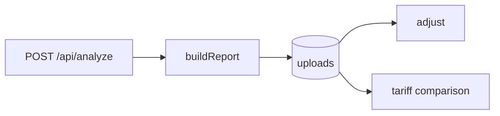

# Mental model

Produce `docs/mental-model.md`: a single document a new contributor (human or agent) reads **before** touching the code, so they hold the right picture of the system in their head. It is not API reference and not a feature list — it is the shape of the thing, the one or two flows everything hangs off, and the traps.

If `docs/mental-model.md` already exists, refresh it in place: keep its structure, correct what drifted, add what's new, and bump the "Last written" line. Don't rewrite a doc that's still mostly right.

## 1. Read the code, not just the docs

The doc is only useful if it's true, and existing docs (CLAUDE.md, READMEs, plans) drift. Treat them as leads to verify, not sources to copy.

Work roughly in this order, reading whole files where they're central and skimming the rest:

1. Workspace/package layout (`package.json` workspaces, `apps/*`, `scripts/`), `docker-compose.yml`, deploy scripts and CI workflows — gives the boxes.
2. Server entry point (`apps/server/src/index.ts`) — every mounted router and middleware, startup jobs.
3. The core pipeline (here: `reportPipeline.ts` and the route/service that calls it) — this is the flow the doc centres on.
4. `database/types.ts` and the migrations list — the data model.
5. Each frontend's router/entry and its `api.ts` — which endpoints each app actually uses.
6. Middleware (auth, CSRF, rate limits), crypto, cache — cross-cutting rules.
7. `docs/adr/`, `docs/calculations.md`, `docs/plans/` titles, and project memory — for decisions and the *why*.

While reading, keep a list of **discrepancies**: docs that contradict the code, conventions the code breaks, and things that look like bugs. These are some of the most valuable output of the exercise (see step 4).

## 2. Write the doc

Use this skeleton. Drop a section if it has nothing true to say; don't pad.

```markdown
# Mental model — <product name>

<one line: what this doc is + links to calculations.md, adr/, plans/>
_Last written: YYYY-MM-DD (vX.Y.Z from package.json)._

## 1. What the product is, in one breath
## 2. The shape of the system            ← diagram: boxes and arrows
## 3. The core loop                      ← diagram: the main data flow
## 4. Domain vocabulary                  ← table
## 5. Server conventions                 ← bullets + middleware table (+ optional auth sequence)
## 6. Data model                         ← table, optional small ER diagram
## 7. Frontends
## 8. Static data that drives results
## 9. Running & shipping
## 10. Invariants & traps (read before editing)
```

Writing guidance:

- **Explain consequences, not inventory.** "`parsed_rows` is stored, so adjust and tariff comparison can re-run the pipeline without the CSV" teaches more than listing the column.
- **Link, don't duplicate.** Point at `calculations.md`, ADRs and plans instead of restating them; the doc stays short and doesn't go stale twice.
- **Name real files and functions** (`services/reportService.ts`, `buildReport`) so readers can jump straight there.
- **Tables for lookups, diagrams for flows, prose for reasons.** A vocabulary list or an env-var list is a table, never a diagram.
- **Traps section is the payoff.** Include things that would bite an editor: encryption invariants, cache-invalidation duties, performance rules, "never run migrations", knobs that silently change every report.

## 3. Diagrams: Mermaid, and keep them simple

All diagrams go in fenced ` ```mermaid ` blocks inside the markdown — never ASCII art, images, or external tools. Mermaid renders on GitHub and in most editors, and it's diffable text.

The point of a diagram is to be understood in a few seconds. A diagram that needs studying has failed; split it or replace it with a table. Rules of thumb:

- **One idea per diagram.** System shape, the core flow, a re-run path, an auth handshake — separate diagrams, not one mega-chart.
- **About 12 nodes max.** If you need more, you're showing two ideas, or listing things a table would hold better. Group with a `subgraph` only when the grouping is itself the point (e.g. "served by nginx").
- **Short labels.** A name plus at most one short detail line (`<br/>`). Thresholds and formulas belong in the text or `calculations.md`.
- **Straight flow.** Pick `TD` or `LR` and keep arrows going one way; avoid crossing edges and back-references unless the loop *is* the point. Label edges only when the label adds information.
- **Right diagram type:** `flowchart` for structure and data flow, `sequenceDiagram` for request/response between actors (auth, external calls), `erDiagram` for tables — with only the key columns, not every field.
- **Render-safe syntax:** quote labels containing punctuation (`a["POST /api/x"]`), use `<br/>` for line breaks, write "under/over" instead of `<`/`>` or HTML entities, and avoid `end` as a bare node id.

Simplify example — instead of one flowchart with every service, every endpoint and the cache:



…and put the per-stage detail in a short numbered list or a second diagram scoped to just the pipeline.

Before finishing, reread each diagram cold and ask: would someone new get this in ten seconds? If not, cut nodes.

## 4. Report back

- Tell the user where the doc is and summarise what it covers in a few lines.
- List the discrepancies you found (stale docs, convention drift, likely bugs) with `file:line` references. Note them in the doc's traps section where relevant, but **don't fix code or other docs unasked** — offer to.
- Don't commit; the user commits.
